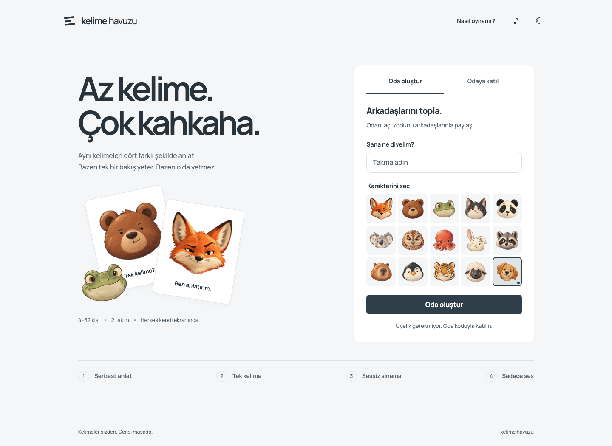
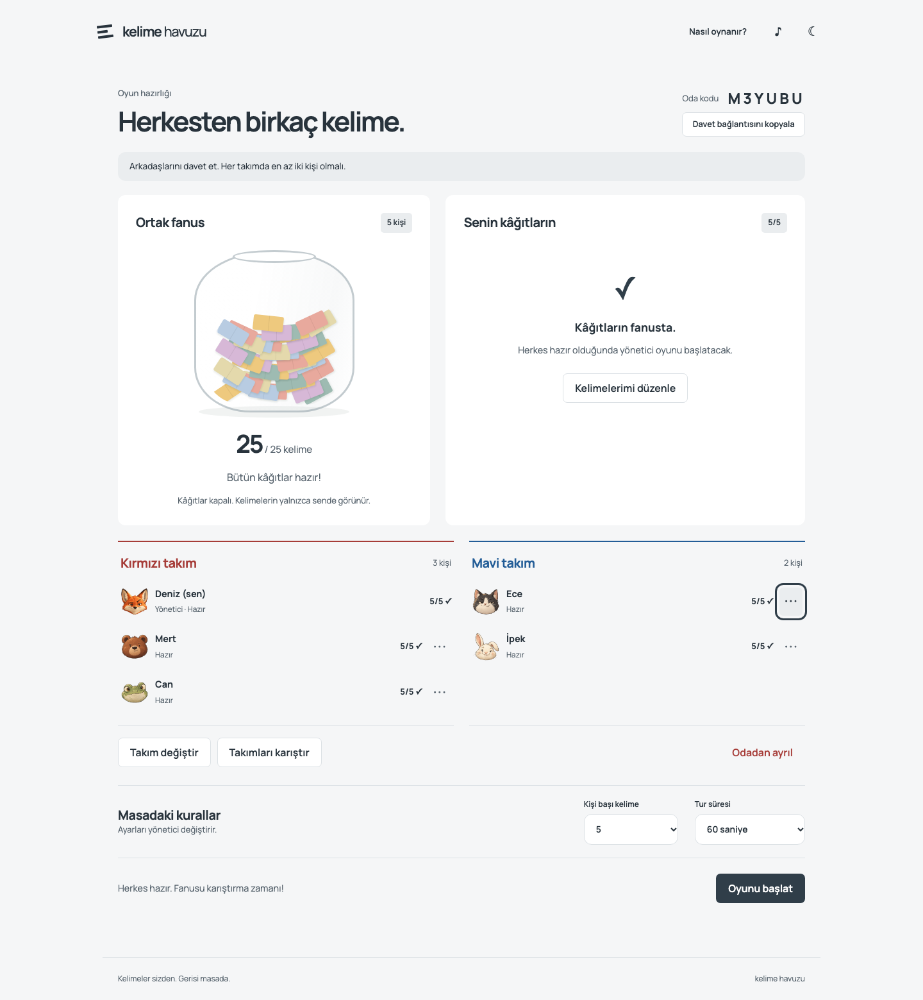
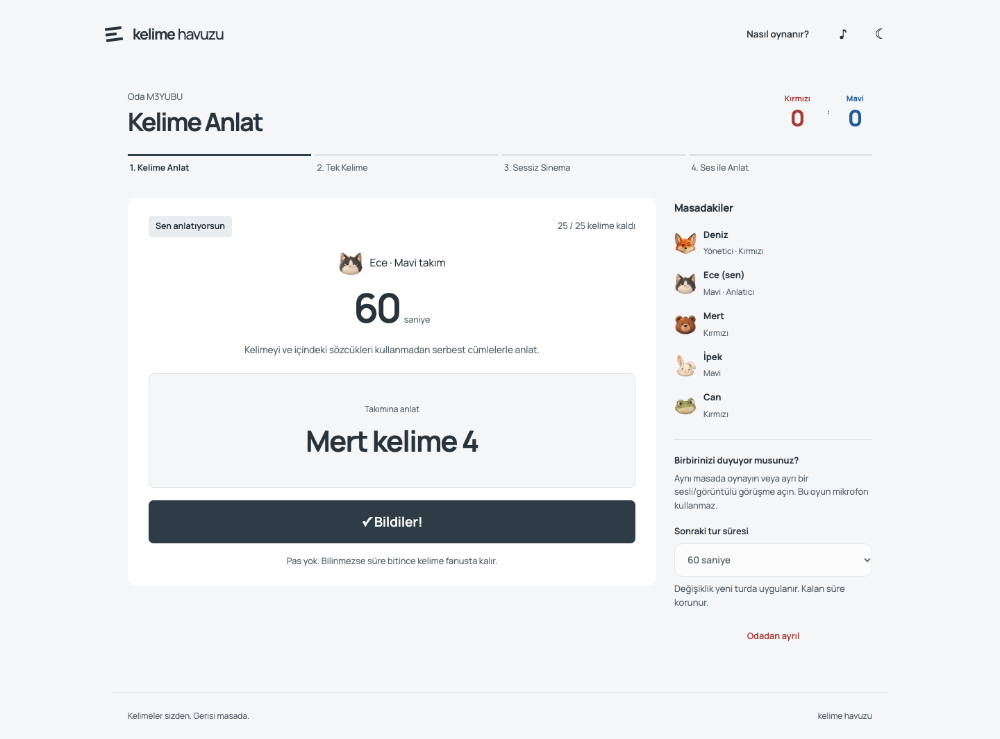

# Kelime Havuzu

Bir fanus, iki takım, dört anlatım şekli. Türkçe, mobil uyumlu, gerçek zamanlı arkadaş oyunu.

**4–32 oyuncu**; 5, 7 veya başka tek sayıda oyuncuyla da oynanır. Her takımda en az iki kişi gerekir. Odayı açan oyuncu yönetici olur; herkes kendi cihazından oda koduyla veya davet bağlantısıyla katılır.

## Oyun

Herkes 5–10 kelime/ifade yazar. Fanus yazıldıkça dolar; arkadaşların yalnızca yazılan adedi görür. Onaylar tamamlanınca oyun başlar. Aynı kelimeler sırasıyla serbest anlatım, tek kelime, sessiz sinema ve sadece ses kurallarıyla tekrar kullanılır. Doğru tahmin 1 puan; pas yok. Aşama sonunda kalan süre korunur.

Kelime anlatıcıya ve rakip takıma görünür; anlatıcının takımından gizlidir. Rakip kural ihlaline itiraz edebilir. Süre durur, yönetici karar verir. Geçersiz kelime bu aşamada puansız çıkar. Son doğruya 5 saniyelik itiraz penceresi vardır.

Oyun mikrofon/kamera içermez. Aynı ortamda veya ayrı bir görüşme uygulamasıyla oynanır.

## Yerelde çalıştırma

Node.js 22 veya 24 ve npm gerekir (önerilen çalışma sürümü `.node-version`).

```sh
npm ci
npm start
```

Tarayıcıda `http://localhost:3000` açılır. Varsayılan kayıt dizini `state/`; Git'e eklenmez. Aynı cihazda oyuncu denemek için ayrı tarayıcı profilleri/özel pencereler kullanın. Bir oyuncunun oturumunu kopyalanmış sekmelerde eşzamanlı kullanmak önceki bağlantıyı kapatır.

```sh
npm run lint
npm test
npx playwright install chromium webkit
npm run test:e2e
```

## İnternette yayımlama

Bu uygulama sürekli çalışan **Node.js + WebSocket sunucusu** ister; statik site barındırmasına tek başına konamaz. Tek replika ve kalıcı disk kullanılır. [Türkçe yayın kılavuzu](docs/YAYINLAMA.md) Render Blueprint ve Docker kurulumlarını açıklar. `render.yaml`, `Dockerfile` ve `compose.yaml` hazırdır. Blueprint ücretli servis/disk oluşturur; kurulumu başlatmadan sağlayıcının ücretini kontrol edin.

- Sağlık kontrolü: `/healthz`.
- HTTPS kullanın; `.env.example` değişkenlerini servis ortamına ekleyin.
- Sunucu yeniden başlarsa kayıtlar geri yüklenir, aktif oyun güvenli biçimde duraklar. Yönetici bağlı oyuncularla devam ettirir.
- Yatay ölçekleme desteklenmez. Birden çok replika veya cluster kullanmayın.

## Dosyalar

- `src/game.js`: saat enjekte edilebilir oyun motoru, doğrulama, puan ve rol görünürlüğü.
- `server.js`: HTTP/Socket.IO, komut onayları ve tekrar koruması, bağlantılar, hız sınırları.
- `src/persistence.js`: atomik disk kaydı.
- `public/`: bağımlılıksız tarayıcı arayüzü, fanus, karakterler, gündüz/gece teması.
- `test/`: motor, gerçek socket, kalıcılık ve Chromium/WebKit tarayıcı senaryoları.

[Oyuncu kılavuzu](docs/KULLANIM_KILAVUZU.md) · [Kararlar ve sınırlar](docs/DECISIONS.md) · [Doğrulama notları](docs/QA.md)

## Katkı ve gizli bilgi kontrolü

Commit öncesi kontrol için `gitleaks` kurup `git config core.hooksPath .githooks` çalıştırın. Hook staged değişiklikleri tarar; `.env` ve `state/` Git dışında tutulur. Biçim kontrolü `npm run format:check`, düzeltme `npm run format` ile yapılır.

## Arayüz

Yerel Manrope fontu, açık/koyu tema ve 15 özgün hayvan portresi. [Tasarım ve görsel üretim notları](docs/ART_DIRECTION.md).







Docker daemon açıkken tam üretim imajı ve restart kontrolü için `npm run test:docker` çalıştırılabilir. Test yalnızca kendi oluşturduğu geçici container ve volume'u temizler.
